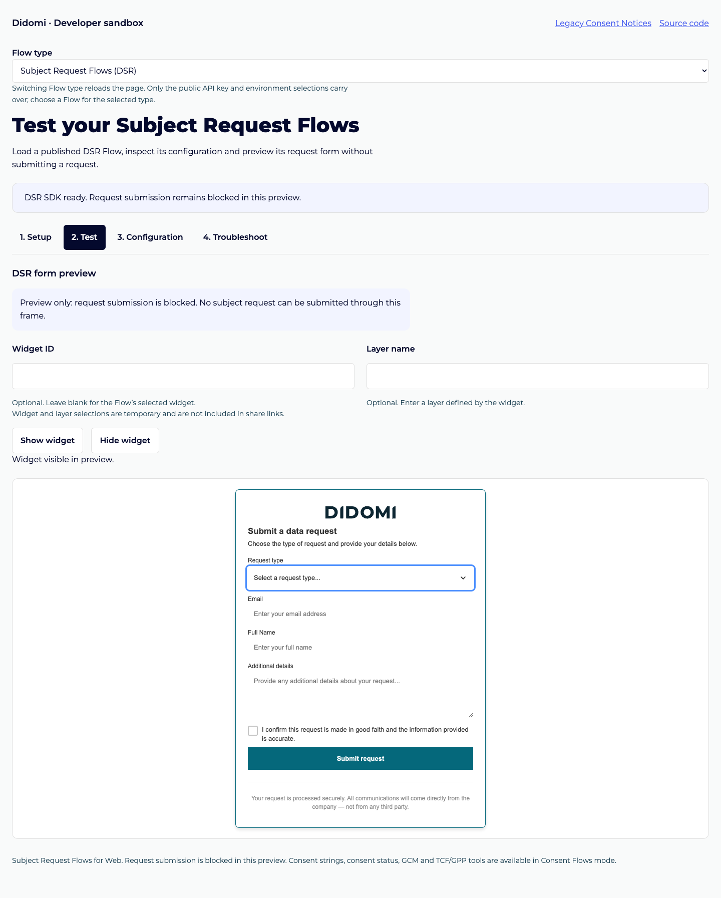

# Subject Request Flows

The sandbox uses one repository and two product entry points. Consent Flows
remain the default. `flow_type=dsr` selects Subject Request Flows (DSR),
independently of a regulation name such as GDPR.

## Testing a published DSR Flow

Select Subject Request Flows (DSR), enter the public API key and Flow ID, select
the platform environment and publication, then apply and reload. Only Web is
supported. Optional Country, Region and Regulation settings select delivery.
A draft alone is not loadable. No consent SDK, consent stubs or consent-state
probes are initialized in this mode.

The Test tab displays the published form in an opaque-origin, script-only
sandboxed iframe. Show/Hide use the DSR SDK's widget API. Optional widget and
layer selections are temporary and excluded from share links. SDK readiness
and observed widget visibility are reported separately. If an explicit Show
action does not produce a visible widget, Troubleshoot offers checks to try.

Configuration uses the shared tree/plain JSON viewer with the resolved
`DidomiDSR.getConfig()` response. It includes the preview's generated CSP nonce.
Copy includes all returned configuration fields, not values entered into the form.
A default widget with no explicit display rules is valid. A brand reference is
valid DSR metadata; CMP-specific brand/consent requirements are not applied.
Troubleshoot checks DSR identifiers, routing references and published web assets.
Failures after a configured load attempt select Troubleshoot; empty setup does not.
HTTP status details for failed script loads require the browser Network panel.

## Submission-free preview

The frame's browser-enforced policy sets `connect-src 'none'` and
`form-action 'none'`, and its sandbox grants scripts only. It has no same-origin,
form, popup or top-navigation permissions. Fetch, XHR, beacon and WebSocket
connections are blocked. An attempted SDK submission is reported as blocked,
never as backend success. The form may show its own submission error as well.
No form values are copied to the parent, share links or configuration exports.
Use synthetic test data when exploring validation and form behavior.

The SDK's inline module wrapper receives a fresh per-frame CSP nonce through
`app.nonce`; arbitrary inline scripts remain blocked. A private MessageChannel
carries configuration and widget-control/status messages between the parent and
frame. The parent cannot inspect the frame DOM, and the frame cannot access the
parent's globals. The runner accepts initialization only from its parent and
validates the loader host/path before inserting the script.

Remote scripts, styles, fonts and images may load. Assets that require fetch/XHR
cannot load in this mode; troubleshooting reports blocked connections. The preview
does not validate successful request creation, email delivery, request tracking
or authenticated administration. No live submission mode is included.

Switching products navigates to a fresh document at the same deployment and
path. Only `apiKey`, `environment` and `sdk_environment` carry over. Flow IDs,
geographic settings, arbitrary JSON, user identities, widget/layer selections
and SDK pins do not transfer. Existing Consent Flow URLs and their configuration
behavior remain supported. Unsupported product types show an error without
starting an SDK.

Product-specific runtime and validation logic should stay separate. Share
navigation, viewers, presentation and URL utilities only where their behavior
matches. DSR must not inherit CMP readiness queues, reset actions, consent
strings, GCM or TCF/GPP tools.

## Follow-up delivery

1. Foundation: explicit product selection, document isolation and URL compatibility.
2. DSR runtime: loading, widget controls, configuration and routing/asset diagnostics.
3. Release validation: broader cross-product browser regressions, documentation,
   screenshots and a recording. Focused tests belong in each preceding change.
4. Optional follow-up: richer submission diagnostics and verified mock submission
   support if they require additional SDK capabilities.

Any future real-submission mode requires a separate explicit design and test
plan. Keep backend request creation distinct from this submission-free preview.

## One cumulative deploy preview

Keep the DSR integration PR open from `codex/dsr-flow-sandbox` into `main`.
Create subsequent review branches from that integration branch and target their
PRs back to `codex/dsr-flow-sandbox`. Merge each reviewed change into the
integration branch to update its Netlify deploy preview. The feature reaches
production only when the integration PR is merged into `main`.

Netlify previews represent the head branch of a PR. Opening a child PR alone
does not add its commits to the integration preview. A child PR may have a
separate preview, but the integration PR's preview is the cumulative test URL
after child changes merge into it. Keep later branches current with the
integration branch to avoid mixing unrelated changes or retesting an older base.

Use the preview URL reported by Netlify after the integration PR is opened;
do not assume a PR number or deployment URL in advance.

## Demonstration

[Mobile preview after a blocked submission](media/dsr/preview-mobile.png)

[Watch the preview walkthrough](media/dsr/preview-walkthrough.webm): load the
form, hide/show it and attempt a submission using synthetic data. The preview
reports the submission as blocked; no real subject request is created.
